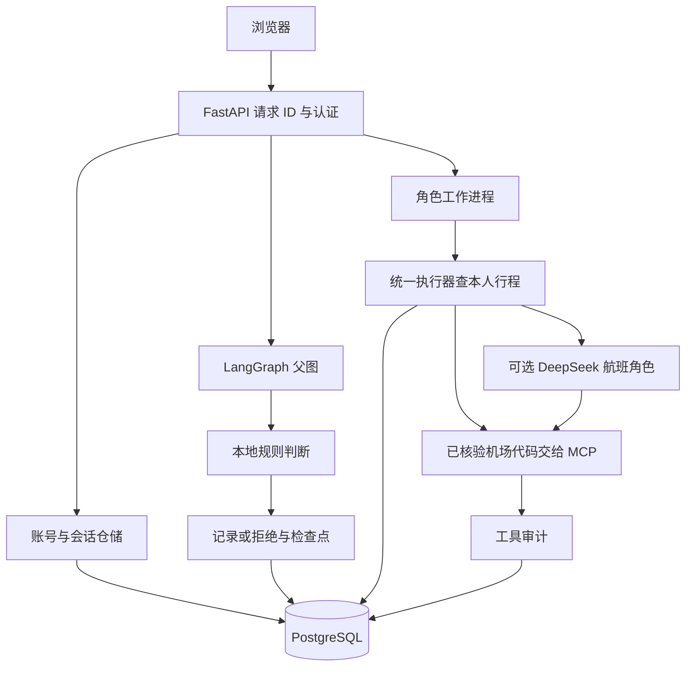

# 正式应用架构

## 模块和入口

- `run-local.ps1` 管理本地准备、前台 Uvicorn、依赖状态和停止。`compose.local.yml` 管理三个绑定回环地址的容器。
- `web_app/app/runtime.py` 是提供首页、认证、会话、行程、工具和健康检查的 FastAPI 入口。`operations.py` 生成请求 ID、统一错误和依赖状态，`local_tools.py` 管理工具工作进程和模型额度。
- `customer_support_chat/app/business/` 管理 PostgreSQL 配置、账号、会话和行程仓储。`migrations/` 以 Alembic 更新业务 schema。
- `customer_support_chat/app/workflow/` 管理 LangGraph 路由、PostgreSQL 检查点和每会话 advisory lock。`customer_support_chat/app/tooling/` 管理工具权限、输入输出校验、超时和独立审计。
- `flight_role_validation/` 保留原有 LangChain v1 角色、DeepSeek 限额、机场 MCP 及进程入口。当前主应用复用这些模块。API 和角色在两个受锁的环境中运行，以兼容现有 LangChain 版本。
- `web_app/app/main.py`、`customer_support_chat/app/graph.py`、`customer_support_chat/app/services/`、`faq_extension/`、`vectorizer/` 记录历史应用和可复用模块。原流程有独立设置、SQLite、文件会话或内存检查点，也可能依赖外部服务。维护和迁移时以当前正式 API 为接入边界。

## 请求链路

登录后使用 HttpOnly 会话 Cookie，数据库只存 token 摘要。路由根据认证身份筛选数据，HTTP 请求不接受用户 ID 作为授权依据。父图从本人已保存消息取输入，执行本地约束判断并将结果保存到独立 schema。检查点不是跨会话偏好记忆。消息先持久化，检查点事务失败时返回可核对的消息 ID。

航班请求通过统一执行器读取本人合成行程。在 `deepseek` 模式，先核对所有权，再将目标演示行程交给有界角色。机场执行获取经过核验的机场代码，采用固定本机 MCP server、严格工具表和角色权限。审计与 HTTP 共用请求 ID，代码不记录原始航班查询参数或原始模型响应。审计写入是有界的尽力交付，目前不用于保证订单事务。

PostgreSQL 为核心依赖。Redis 与 Qdrant 运行探针和独立存储验证，当前请求路径没有使用它们做缓存或 RAG。MySQL 连接探针可独立运行。LangSmith 在旧路径中有使用记录，当前正式链路是本地请求日志与数据库工具审计，模型角色显式关闭外发追踪。启用生产追踪需先验证字段脱敏和外部服务配置。

## 功能盘点与迁移

- **已实现且可运行**。FastAPI 网页与认证、PostgreSQL 所有权隔离、会话及检查点持久化、父图记录/拒绝、组合航班和本地机场查找、工具执行审计。
- **已实现但未集成**。历史 WooCommerce、WordPress、表单、GoHumanLoop、SQLite 业务工具和文件会话保留。迁移前应确认配置、权限、数据契约、安全策略和外部沙箱；旧服务完成度不能由源码存在推定。
- **部分实现**。父图端的自动业务编排目前到记录/拒绝，航班是同一应用中的独立业务操作。FAQ 代码有扫描、解析、索引和查询入口，但正式仓库没有受支持的 FAQ 数据目录、版本发布和效果验收。酒店有种子与库存表，网页尚无酒店查询、审批或订单写入。
- **尚未实现**。正式 P6 酒店交接、P7 事务性审批预订、P8/P9 知识版本与混合检索、P10 跨会话偏好、P11 质量评估。
- **外部阻塞**。旧 WooCommerce 和相关网页业务缺少已验证的沙箱凭据及安全验收条件，RAG 缺经核验的语料与模型配置。外部订单、表单与真实预订没有执行。当前 DeepSeek 实测结果见 [验证记录](VERIFICATION.md)。

`p1-local-runtime` 至 `p5-unified-tool-execution` 均为本地 `main` 的祖先，历史阶段分支没有独有提交。旧阶段工作区和来源仓库保留。旧 P2 未跟踪手册及来源仓库未跟踪文档原位保留。迁移按已验证路径逐项接入现有代码和数据库。
