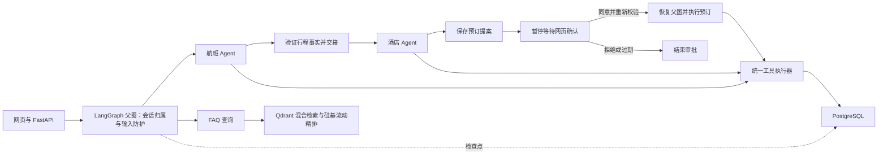

# M2 · 旅行客服 Multi-Agent 架构设计

2026-11-21 · 本地部署首版 · ADR-01 方案 B 已确认

本文是开发依据。文档写入与各开发阶段分别审批，每个阶段通过验收后可独立提交。开发前锁定依赖和镜像版本，推送前核对目标仓库和待发布内容。

## 1. 业务目标与边界

首版面向实习面试演示。用户登录本地演示账号，查询自己的航班，从航班 Agent 交接给酒店 Agent，按当地到达日期与住宿偏好获得推荐，然后在网页上确认一份酒店预订提案。系统恢复原会话的执行并创建一笔演示预订。FAQ 查询独立可用，也可以为上述流程提供政策说明。

- 首版包含两个隔离的合成用户、航班与酒店查询、网页确认、可追溯的 FAQ、跨会话偏好、工具审计和 LangSmith 调用链。
- 首版旅行写操作为 `book_hotel`。用户需明确表达预订意图，并确认包含酒店、入住和退房日期、房型及演示价格的提案。偏好写入遵循独立的用户授权和删除规则。
- 真实支付、航空改签、与真实酒店下单、飞书审批及生产级容量承诺属于后续范围。演示数据在界面明确标识。

## 2. 技术栈与决策状态

| 状态 | 决定 | 理由或约束 |
| --- | --- | --- |
| 已确认 | FastAPI 异步 API，复用现有 Web 交互 | 将认证、会话归属和审批接口放在服务端，复用演示界面。首版以 JSON 请求和状态查询完成交互。 |
| 已确认 | LangGraph 父图，LangChain v1 `create_agent` 角色 Agent | 父图掌管可验证的业务流程，角色封装各自的模型与工具循环。 |
| 已确认 | Docker PostgreSQL | PostgreSQL 保存检查点、行程、库存、预订、审批、审计和偏好。业务写入用事务与唯一约束。 |
| 已确认 | 本机 MySQL | 保存 FAQ 原文、来源和发布版本，用于校订与重建检索索引。 |
| 已确认 | Docker Qdrant | 保存向量、全文索引与检索元数据。混合检索与过滤在同一服务内执行。 |
| 已确认 | 复用本机现有 Docker Redis | 缓存高频公共 FAQ 的检索结果，缓存失败时可按时限直接检索。 |
| 已确认 | DeepSeek 对话模型，硅基流动 `BAAI/bge-m3` 与 `BAAI/bge-reranker-v2-m3` | 模型调用、嵌入和精排分层，以独立适配器管理限时和错误。 |
| 已确认 | LangSmith | 查看一次请求中的角色切换、工具调用、检索结果和审批恢复，发送前按字段脱敏。 |
| 暂定 | `AsyncPostgresSaver`、Psycopg 3、异步 SQLAlchemy Core 与 Alembic | 检查点表由 saver 的初始化流程管理，业务表用业务迁移管理。先验证版本组合。 |
| 暂定 | FAQ 24–32 条、酒店 8–12 家、合成行程 6–10 条 | 规模够覆盖主要演示和回归场景，按实际覆盖率调整。 |
| 待验证 | 最新稳定且兼容的 Python 依赖和 Docker 镜像、中文 BM25、DeepSeek 多轮工具调用和结构化输出 | P1 锁定 Python 与镜像版本，P4 验证模型工具协议，P9 验证搜索效果。Qdrant 原生全文 BM25 要求服务端 1.20 起。 |
| 待提供 | GitHub 目标地址、各外部服务密钥 | 密钥在相应开发阶段通过本机环境或本地忽略文件配置。目标地址在首次推送前核对。 |

应用首版本机运行。PostgreSQL 和 Qdrant 在 P1 用固定镜像标签、本地端口和各自的数据卷部署。P1 核对本机端口、MySQL 用户权限及 Redis 连通性。连接池、超时与并发上限用于保护数据库和模型配额，容量由实际负载测试决定。

## 3. ADR-01 · 采用父图与角色 Agent

**状态**　已确认，选项 B。原项目的 [`Assistant.__call__`](../../../customer_support_chat/app/services/assistants/assistant_base.py#L24) 将图状态传给 Runnable，父图通过 [`route_primary_assistant`](../../../customer_support_chat/app/graph.py#L410) 路由。当前确认路径在 [`process_user_decision`](../../../customer_support_chat/app/services/chat_service.py#L338) 中 [直接调用预订工具](../../../customer_support_chat/app/services/chat_service.py#L395)。迁移角色 Agent 时，写入路径同步收敛到父图的审批后执行节点。

| 选项 | 架构 | 取舍 |
| --- | --- | --- |
| A | 父图显式组织角色 Runnable 与工具循环 | 改动较小，角色循环需自行维护。作为兼容性回退路径。 |
| **B · 已选** | LangGraph 父图管理业务流程，航班和酒店各自使用 `create_agent` | 能独立验证 Handoff、上下文隔离和审批。需要编写父图输入输出适配和工具 middleware。 |
| C | 一个 `create_agent` 按状态切换角色、上下文与工具 | 运行入口集中，切换角色和审批恢复更依赖同一套 middleware。 |

父图先校验会话归属和输入，再决定 FAQ 或航班等业务分支。航班角色提供已验证的行程事实。父图检验当前用户、到达城市、当地日期与时区、证据来源，再把下一轮对话责任交给酒店角色。酒店角色生成建议和预订提案。只有父图的审批后节点能执行 `book_hotel`。角色 `create_agent` 通过包装节点按次接收所需上下文，父图拥有工作流检查点和恢复入口。

P4 先用一个航班角色验证 DeepSeek 多轮工具调用、统一执行器接入、结构化输出和角色隔离。运行时发现的 MCP 工具同时经过模型侧选择和执行侧权限判断。若角色循环兼容性失败，保留父图和角色输入输出约定，先用方案 A 完成主线。 [LangChain middleware](https://docs.langchain.com/oss/python/langchain/middleware/overview) · [LangChain 动态工具](https://docs.langchain.com/oss/python/langchain/tools#dynamic-tool-selection) · [LangGraph 子图](https://docs.langchain.com/oss/python/langgraph/use-subgraphs)

## 4. State、Context、Tool 与 Memory

### State 与上下文装配

父图状态以 `thread_id` 对应会话，包含当前角色、已验证行程事实及来源、待审批 `action_id` 和执行结果引用。用户身份由服务端认证取得。审批和业务状态以 PostgreSQL 业务记录为准，恢复前重查归属和有效性。

每次角色执行前，装配器按角色和 token 预算生成输入，依次加入角色规则、当前任务及限制、经验证的交接事实、适用的偏好、近期相关消息和当前问题。FAQ 查到的证据带上来源及适用条件。酒店角色只获得所需的到达城市、当地日期、时区、住宿约束等信息，以及获准的酒店查询工具。

- **近期**保留约 2–3 轮相关原话，帮助理解指代、最新修改与用户的当前意图。
- **较早期**将已核实的行程和约束提取成带消息或工具结果引用的事实。发生冲突时保留出处，优先采用明确的最新用户约束并重新校验业务事实。
- **早期**保留可按归属查询的原始消息。异步压缩作为单独验证项，按已覆盖的消息位置和摘要版本更新。摘要未完成或无法解释冲突时回查原文。预订字段和已明确表达的关键约束同时保留结构化记录。
- **跨会话**以用户为作用域保存明确表达的预算、房型等偏好，允许读取、修改和删除。当前对话中明确给出的条件优先。删除偏好后，旧摘要也不能让它重新生效。

### 工具注册、权限与审计

注册中心统一登记工具名、用途、JSON Schema、来源和本地权限规则。内置工具在启动时注册。首版通过一个只读 MCP 工具验证动态发现，机场代码查城市可作为验证对象。新发现的工具先走本地授权，Agent 只看到本角色获准的列表，执行器对每次实际调用复验。MCP 的声明不能授予本地权限。

统一执行器处理业务校验、结构化参数错误、查询无结果、超时、权限拒绝、故障和结果裁剪。可恢复的只读网络故障在总时限内有限重试。写入调用默认禁用自动重试，超时先按 `action_id` 查业务回执。保留 `tool_call_id`，结果只返回允许字段，业务枚举转为可理解的文本，JSON 保留中文字符。

`tool_audit_logs` 每次逻辑调用记录一条，包含会话与运行标识、`tool_call_id`、可选 `action_id`、工具名和来源、脱敏参数与结果摘要、结果状态、错误类别、重试次数、耗时和时间。权限拒绝与参数校验拦截也留痕。审计独立限时写入，无业务外键，写入失败发出可观察信号。业务预订回执与订单在同一个事务提交。

### 审批与写入一致性

父图保存服务端生成的规范化提案和唯一 `action_id`，再暂停等待网页确认。提案绑定用户、会话、酒店、日期、房型、价格及过期时间。确认接口接收审批标识与同意或拒绝决定，服务器从已保存的提案取执行参数。确认后恢复原 `thread_id`，执行前再次核对归属、状态与可用性。库存、订单和回执通过同一事务提交。重复确认返回已有结果，库存或价格变化则要求形成新提案并再次确认。若业务事务成功后图恢复中断，重试恢复时先查询已有回执。

首版暂定同一会话同时只允许一个父图执行。等待审批期间用户可以查询状态或提交决定，想修改条件时先拒绝旧提案，再发送新消息。P3 和 P7 一起验证新消息与审批恢复并发时的行为。

## 5. ADR-02 · 默认混合检索与知识库发布

**状态**　检索主路径与双路参数已确认，精排候选与上下文段数暂定。

1. 归一化公共 FAQ 查询并应用品类、语言、知识发布版本等过滤。相同的过滤约束作用于两路召回。
2. Qdrant 同时召回 `bge-m3` Dense Top-100 和原生全文 BM25 Top-100。中文分词先验证 `multilingual` tokenizer。索引与查询使用同一嵌入模型版本，替换旧嵌入时构建新索引。
3. RRF 使用 `k=60` 融合两路排序。`k` 是融合常量，返回条数由 `limit` 控制。暂定取融合前 40 条并去重，交给 `bge-reranker-v2-m3`，取前 10 条作为精排结果。
4. 暂定从精排结果选 4–6 段进上下文，保留原始引用。相关证据集中在上下文首尾的摆放策略可与按精排顺序摆放做小规模对照。按中文同义问法、专有名词、机场代码和无答案样本评估召回、引用正确率和 P95 延迟。精排超时可以回退至 RRF 并标记降级。
5. Redis 按知识版本、归一化查询、过滤和检索配置缓存公共 FAQ 证据结果。个人行程、偏好、库存和审批状态走业务存储。索引验证通过后才更新 MySQL 的生效版本。单次请求读取一次生效版本，用同一版本选择 Qdrant 集合和缓存键。回退时切回旧版本。

[Qdrant 原生 BM25](https://qdrant.tech/documentation/manage-data/indexing/#bm25-scoring) · [混合查询与参数化 RRF](https://qdrant.tech/documentation/search/hybrid-queries/)

### 数据来源与规模

- FAQ 先覆盖行李、航变、改签、退款入口及住宿常见问答。查阅公开资料后改写，保留来源 URL、核对日期、适用条件、语言和版本。政策适用性缺少票种或购买渠道等信息时，引导用户核对。 [SWISS 行李异常](https://www.swiss.com/ch/en/prepare/baggage/baggage-irregularities) · [SWISS 航班取消](https://www.swiss.com/ch/en/book-and-manage/rebook/involuntary-rebooking)
- 酒店优先选苏黎世机场和市区。名称、区域及必要设施以旅游局或酒店官网核对，演示价格、库存、取消条款、用户、航班和订单用合成数据。数据需覆盖跨午夜抵达、预算筛选、机场酒店和无库存。 [苏黎世住宿目录](https://www.zuerich.com/en/inform-plan/find-accommodation) · [机场酒店目录](https://www.zuerich.com/en/inform-plan/find-accommodation/hotels/airport-hotels)
- MySQL 保存原文、来源、草稿和发布版本。独立索引任务构建对应的 Qdrant 集合，抽样检查后激活。聊天请求用异步 I/O 访问数据库和服务商。索引构建脱离聊天请求执行，首版使用独立命令行任务。持久化队列和自动调度可在需要恢复后台任务或扩大吞吐时再评审。

## 6. API、数据库和模块边界

以下名称是实现计划的候选，路径命名与表拆分在对应阶段锁定。

| API 能力 | 参考路由 | 主要约束 |
| --- | --- | --- |
| 创建会话 | `POST /api/threads` | 服务端确定用户并生成会话标识。 |
| 发送消息 | `POST /api/threads/{thread_id}/messages` | 检查归属，返回答复、状态或待确认的提案。 |
| 获取状态 | `GET /api/threads/{thread_id}` | 返回当前角色、会话状态和可展示的审批或预订结果。 |
| 提交审批 | `POST /api/threads/{thread_id}/approvals/{action_id}/decision` | 用户提供决定，服务器按原提案恢复并保证幂等。 |
| 跨会话偏好 | `GET`、`PATCH`、`DELETE /api/me/preferences` | 仅操作当前用户的数据。实时读取当前有效偏好。 |

| 存储 | 数据与约束 |
| --- | --- |
| PostgreSQL | 用户、会话及消息，演示行程、酒店、库存与订单，审批和幂等回执、用户偏好、工具审计。业务表与 LangGraph 检查点表独立管理。 |
| MySQL | FAQ 文档及版本、政策来源、知识版本和生效状态。支持从已发布原文重建索引。 |
| Qdrant | FAQ 切片、稠密向量、全文索引、品类、语言、知识版本及引用元数据。 |
| Redis | 带 TTL 的公共 FAQ 检索缓存。服务不可用时降级到限时查询。 |

| 类型 | 文件或模块 | 设计方向 |
| --- | --- | --- |
| 保留 | [文档解析 `parse_document`](../../../faq_extension/document_parser.py#L8)、[文本切分 `recursive_character_splitting`](../../../vectorizer/app/vectordb/chunkenizer.py#L3) | 复用解析与切分基础，加上来源和版本元数据。 |
| 保留 | [Web 入口](../../../web_app/app/main.py#L31)、既有角色提示词 | 保留演示界面与可用业务表述，替换固定用户的会话通路。 |
| 重构 | [`StateGraph` 的输入防护](../../../customer_support_chat/app/graph.py#L103)、[路由](../../../customer_support_chat/app/graph.py#L410)与[内存检查点](../../../customer_support_chat/app/graph.py#L474) | 明确拒绝分支、Handoff、持久化与恢复。 |
| 重构 | [`Assistant.__call__`](../../../customer_support_chat/app/services/assistants/assistant_base.py#L24)、[`process_user_decision`](../../../customer_support_chat/app/services/chat_service.py#L338)、[`book_hotel`](../../../customer_support_chat/app/services/tools/hotels.py#L39) | 用角色 Agent 适配层、服务端审批接口和事务型预订替换现有路径。 |
| 重构 | [`index_faq_docs`](../../../vectorizer/app/vectordb/vectordb.py#L446)、[`search`](../../../vectorizer/app/vectordb/vectordb.py#L730) | 切换为 MySQL 版本化导入和 Qdrant 混检。 |
| 新增 | 角色上下文装配、工具注册与执行、审批与预订存储、FAQ 发布与检索、偏好存储、可观测性和回归评估 | 优先沿用 `customer_support_chat`、`web_app`、`vectorizer` 的职责边界，在各阶段计划中确定文件范围。 |

现状源码链接以审阅基线 `a30f964` 为准，逻辑迁移后需更新定位。

## 7. 分阶段开发与验收

| 阶段 | 依赖 | 交付与验收 |
| --- | --- | --- |
| P0 · 仓库发布基线 | 设计获批及该阶段批准 | 核对跟踪文件、待发布历史和忽略范围。候选提交不含 `.env`、密钥、个人会话、日志和未经核验的数据。 |
| P1 · 本地运行基础 | P0 | 锁定兼容依赖和镜像。PostgreSQL、Qdrant 通过 Docker 运行，本地 MySQL 和现有 Redis 连通。重启后数据仍可读取。 |
| P2 · 会话与业务数据 | P1 | 提供两个合成用户、最小行程和库存。用户 A 不能查询或写入用户 B 的数据，数据可重复导入。 |
| P3 · 父图与检查点 | P2 | 风险输入进入明确的拒绝分支。重启后可恢复同一用户的会话，越权恢复被拒绝。 |
| P4 · 航班角色验证 | P3、DeepSeek 环境就绪 | 使用一个受控只读工具和执行器测试适配器，验证 `create_agent` 多轮工具调用与结构化交接。模型超时或工具循环到达上限时能结束。 |
| P5 · 统一工具执行 | P3，与 P4 验证衔接 | 完成正式执行器，将内置和一个动态发现的只读 MCP 工具接入同一入口。参数错误、无权限、无结果和超时均可辨别，拦截同样落审计。 |
| P6 · 航班到酒店 Handoff | P4、P5 | 输入跨午夜行程时按到达地日期查酒店。缺失关键事实时先追问。酒店角色看不到航班角色完整历史和专属工具。 |
| P7 · 网页审批与预订 | P6 | 拒绝、过期与越权均无写入。等待审批时新消息不会与恢复竞争。重复及并发确认只生成一笔订单，库存与回执一致。中断后可按回执恢复。 |
| P8 · FAQ 与酒店数据 | P1、P2，可与角色开发并行 | 公开事实可核对，合成字段可识别。FAQ 版本能重建索引，构建失败后旧版本仍可查询。 |
| P9 · 混检、精排与缓存 | P5、P8，硅基流动环境就绪 | 验证双路 Top-100、RRF `k=60`、过滤与精排，能追踪降级结果。知识版本变更后旧缓存不命中。 |
| P10 · 跨会话偏好与历史 | P3、P6 | 长对话可找回早期关键约束。新会话能用本人偏好，修改、删除和跨用户隔离有效。 |
| P11 · 评估与演示 | P7、P9、P10，LangSmith 环境就绪 | 展示 Handoff、一次拒绝、一次重复确认和检索对比。量化检索质量与 P95，抽查追踪数据已脱敏。 |

## 8. 风险、回退与发布约定

| 风险或待验证假设 | 验证方式与应对 |
| --- | --- |
| 最新依赖组合与 DeepSeek 工具协议 | 锁依赖并验证模型工具往返、结构化结果和超时。若方案 B 验证失败，使用角色 Runnable 适配器，保留父图接口。 |
| 越狱输入、外部文档或 MCP 内容影响实际工具权限 | 验证输入防护的终止分支、角色白名单和写入审批。把检索和工具返回作为数据传给模型，执行器独立验证权限。 |
| 并发确认、断线或库存变化造成重复订单 | 用唯一 `action_id`、库存事务和原提案校验，覆盖提交后恢复失败、过期提案和重复确认。 |
| 中文 BM25 或精排收益与延迟不稳定 | 用固定样本对比 Dense、双路融合和精排。精排不可用时回退至 RRF，重建失败时切回旧知识版本。 |
| 历史摘要遗漏或复活旧偏好 | 优先结构化事实与实时偏好。保留来源并验证回查与删除。异步摘要可在质量未达标时关闭。 |
| LangSmith、审计或缓存带出私人信息 | 按字段脱敏并抽查。公共 FAQ 缓存拒收带个人标识的查询。密钥、原始私人会话和完整身份信息留在受控存储。 |
| 高并发超出本地硬件、连接池或供应商配额 | 按阶段用实际负载测量，限制同时运行的请求和模型调用，设置超时。大规模部署、队列与水平扩容另行评估。 |

审阅基线已发现 Git 跟踪了会话 JSON、SQLite 数据库和日志。首次推送前既检查候选提交，也检查可达历史。`.gitignore` 需要覆盖 `.env` 及其变体、本地凭据、运行日志、会话文件和个人数据，历史中已跟踪的内容需单独处理。发现敏感历史时先暂停推送并商定处理方式。每个获批阶段的实现通过验收后可独立提交，首次推送前确认用户指定的 GitHub 目标仓库。
